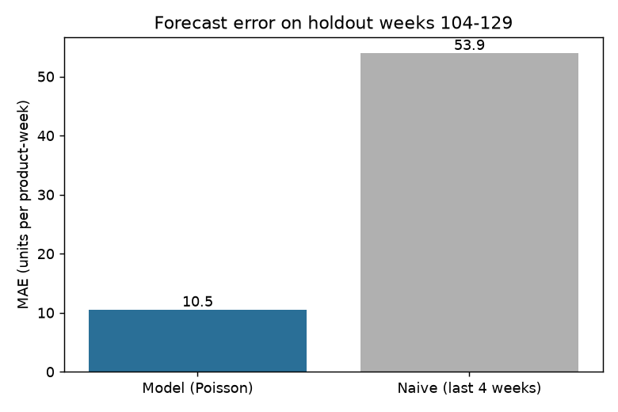
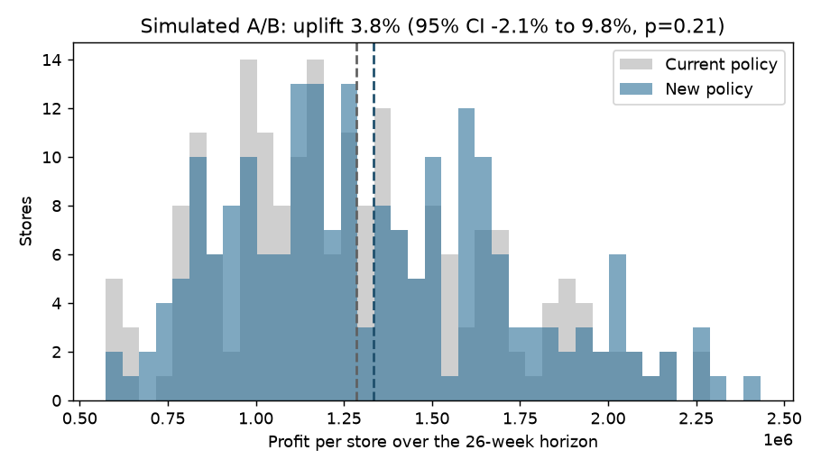
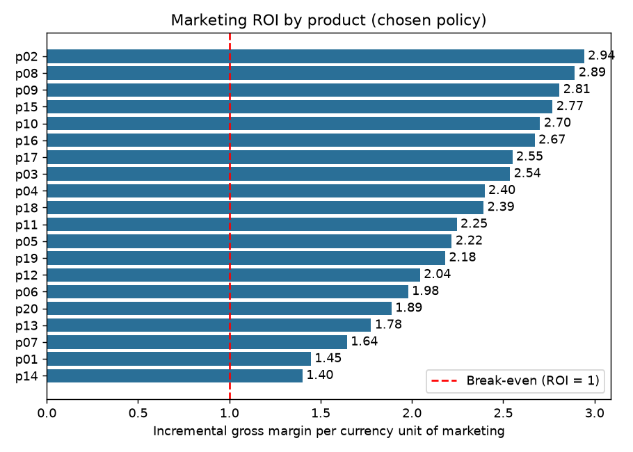
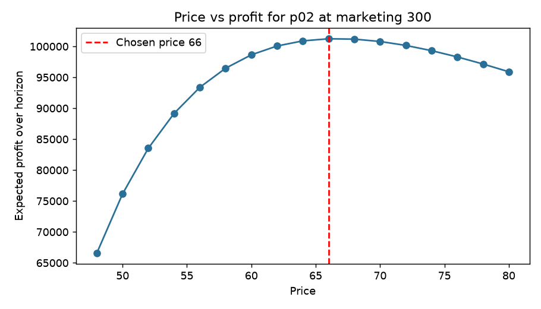

# predictive_decision_making_ML

Machine learning for retail profit decisions: forecast demand, choose price and marketing that maximize profit, and check the result with a controlled experiment.

## Business result

On synthetic data for 20 products over 26 weeks, the recommended policy raises expected profit by **+5.3%** (1,225,272 to 1,289,928). Marketing ROI ranges from 1.40 to 2.94, so each product returns more than its marketing cost. The simulated A/B test shows +3.8% uplift, which is not statistically significant at 200 stores. A 5% uplift needs 549 stores per arm to detect.

Full case study: [docs/caso_de_estudio.md](docs/caso_de_estudio.md).

## Figures

| | |
|---|---|
|  |  |
|  |  |

## Method

1. **Demand model**: Poisson regression with log price, marketing spend (saturating transform), product, and seasonality.
2. **Validation**: out-of-sample forecast error compared with a naive baseline.
3. **Decision**: grid search over price and marketing per product to maximize expected gross margin minus marketing cost.
4. **Experiment**: simulated store-level A/B test with confidence interval, p-value, and sample size.

## Structure

```
predictive_decision_making_ML/
├── README.md
├── docs/
│   ├── caso_de_estudio.md       # executive case study
│   └── figures/                 # charts generated by plots.py
├── src/predictive_decision/
│   ├── data.py                  # synthetic retail data generator
│   ├── forecast.py              # demand model and validation
│   ├── decision.py              # price and marketing optimization, ROI
│   ├── experiment.py            # A/B test and sample size
│   ├── plots.py                 # case study figures
│   └── __main__.py              # end-to-end run and summary
├── tests/test_pipeline.py       # pytest tests
└── .github/workflows/tests.yml  # CI: runs tests on push
```

## Run

```bash
pip install -e ".[test]"
python -m pytest -q
python -m predictive_decision
```

Without installing (PowerShell): `$env:PYTHONPATH="src"`.

## Data policy

All data is synthetic and generated in code. No confidential, company, or personal data is included. The model uses the same functional form as the simulator, so forecast accuracy is optimistic. Real use requires holdout validation by store and time.
